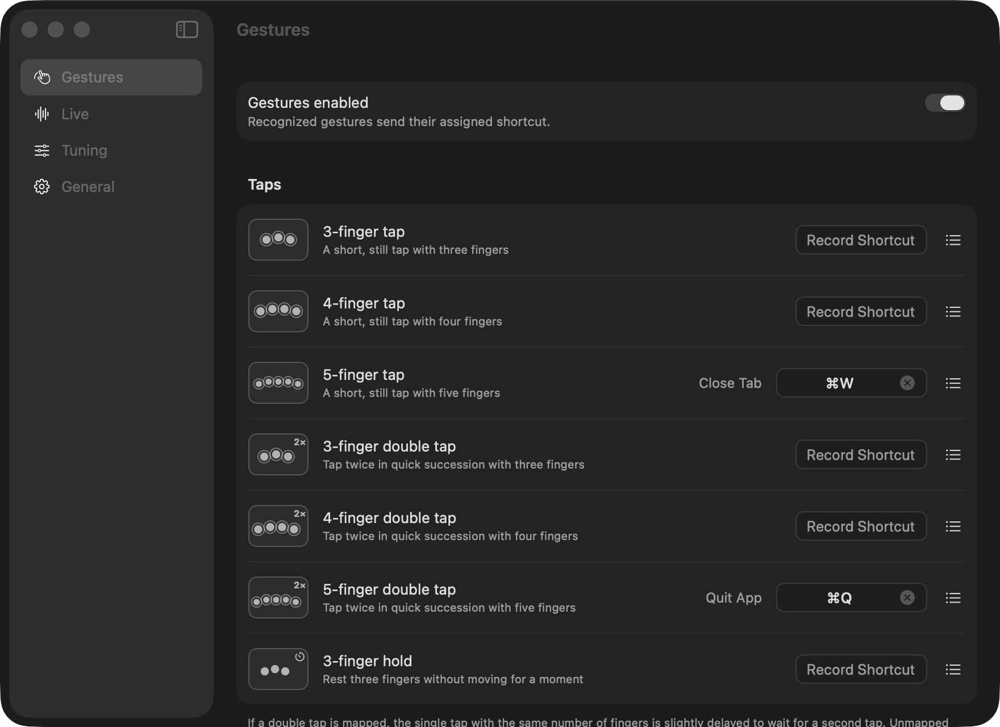

# BetterGestures

A small macOS menu bar app that turns multi-finger trackpad gestures into keyboard shortcuts: taps, double taps, a three-finger hold, TipTap, three-finger swipes and three/four-finger clicks. It works with the built-in trackpad and the Magic Trackpad at the same time.



- Assign a shortcut by recording it or by picking one of ~75 presets (tabs, browser, editing, windows, Spaces, screenshots…).
- A live view draws your fingers and lists every recognized or rejected gesture with the reason, so you can tune thresholds.
- Three-finger scrolling can be blocked, so three fingers only ever mean a gesture.
- Localized in English, Türkçe, Deutsch, Español, Français, 日本語 and 简体中文.

> [!WARNING]
> Raw touches come from Apple's private `MultitouchSupport.framework`. It is not public API and may break with a macOS update. The app is not sandboxed and is not meant for the App Store.

## Install

1. Download `BetterGestures-<version>.zip` from [Releases](https://github.com/ozberkdicle/BetterGestures/releases/latest) and unzip it. Requires macOS 15 or later (Apple Silicon or Intel).
2. Move `BetterGestures.app` to Applications and open it. It lives in the menu bar, not the Dock.
3. Allow it in System Settings → Privacy & Security → **Accessibility** when asked. It's needed to send shortcuts and to filter scroll and click events.
4. Turn off the system's own three-finger gestures (or move them to four fingers) in System Settings → Trackpad, otherwise both will fire.
5. Open **Settings…** from the menu bar icon and assign shortcuts.

The release is signed with a Developer ID and notarized by Apple.

## Build from source

Requirements:

- macOS 15 or later
- Xcode 26 (Swift 6.2; `xcstringstool` for translations)
- An Apple Development signing certificate is recommended (see [Signing](#signing-and-accessibility-permission))

```bash
make run       # build, install to ~/Applications and launch
make settings  # same, with the settings window open
make debug     # run in the terminal with --debug; raw touches are printed (Ctrl-C to quit)
make logs      # stream the logs of an app started with `open`
make test      # unit tests
```

`make install` copies the app to `~/Applications/BetterGestures.app`. The Accessibility permission and "Launch at login" belong to that copy.

On first launch macOS asks for the **Accessibility** permission; reading touches works without it, sending shortcuts doesn't.

`make release` builds the universal, Developer ID signed and notarized zip for a release (one-time setup is described in `Support/release.sh`).

## Gestures

| Config key | Gesture |
|---|---|
| `threeFingerTap` / `fourFingerTap` / `fiveFingerTap` | Short, still tap with 3 / 4 / 5 fingers |
| `threeFingerDoubleTap` / `fourFingerDoubleTap` / `fiveFingerDoubleTap` | Two taps in a row. When mapped, the single tap with the same finger count waits `doubleTapWindow` for the second tap |
| `threeFingerHold` | Rest three fingers without moving; fires while they are still down |
| `tipTapRight` / `tipTapLeft` | One finger rests, another taps to its right / left (repeatable) |
| `twoAnchorTipTapRight` / `Left` | Two fingers rest, a third taps to the right / left |
| `twoFingerTipTapRight` / `Left` | One finger rests, two fingers tap together to the right / left |
| `threeFingerSwipeLeft` / `Right` / `Up` / `Down` | Three-finger swipe; fires once, as soon as the distance is reached |
| `threeFingerClick` / `fourFingerClick` | Press the trackpad down (physical click) with 3 / 4 fingers on it. When mapped, the click itself never reaches the app |

Unmapped gestures add no delay: a single tap waits for a possible second tap only when that double tap has a shortcut.

Only contacts in the `making`/`touching` phase count as fingers; hovering fingers and palm edges do not. Each trackpad is tracked separately. A Magic Mouse is ignored.

## Settings window

Menu bar icon → **Settings…** (⌘,):

- **Gestures**: click a shortcut field and press the keys (the physical key is recorded, independent of the keyboard layout), or pick a preset from the ☰ menu. The row of a recognized gesture lights up.
- **Live**: fingers on each trackpad, and the gesture history with reasons for rejections.
- **Tuning**: recognition thresholds as sliders, applied immediately.
- **General**: permission, scroll blocking, launch at login, devices, config file, debug logging.

While the settings window is in front no shortcuts are sent, so you can try gestures safely (⌘W won't close the window); gestures are only highlighted.

**Block scrolling with 3 or more fingers** (on by default): with the system's three-finger gestures turned off, macOS turns three fingers into a scroll. This option swallows every scroll event of a touch that had three or more fingers on the trackpad, including the scroll that starts while fingers lift and the momentum. Two-finger scrolling and mouse wheels are not affected.

## Config

Mappings live in `~/.config/better-gestures/config.json`; the UI writes every change there. A default file is created on first launch. After editing it by hand press **Reload** in General. If the file cannot be parsed, it is copied to `config.json.bak` before the app writes to it again.

```json
{
  "gestures": {
    "fourFingerTap": "cmd+w",
    "tipTapLeft": "ctrl+shift+tab",
    "tipTapRight": "ctrl+tab"
  }
}
```

Modifiers: `cmd`, `shift`, `alt`/`opt`, `ctrl`, `fn`. Keys are physical ANSI positions (for example `]` is the key where `]` is on a US keyboard); `keycode:30` gives a raw key code. On non-US layouts prefer layout-independent keys such as `tab`, arrows and letters. Arrow and function keys are sent with the same `fn` flag a real keyboard sets, so system shortcuts like `ctrl+right` (move one Space) match.

The optional `tuning` section overrides thresholds; missing fields keep their defaults. Distances are normalized (trackpad width = 1), times are in seconds.

| Field | Default | Meaning |
|---|---|---|
| `tapMaxDuration` | 0.35 | Tap: first finger down → last finger up |
| `tapMaxMovement` | 0.03 | Tap: maximum movement of any finger |
| `doubleTapWindow` | 0.25 | Double tap: maximum gap between the two taps |
| `holdDuration` | 0.5 | Three-finger hold: time to stay still |
| `holdMaxMovement` | 0.03 | Three-finger hold: maximum movement of any finger |
| `tipTapAnchorMinHold` | 0.15 | TipTap: the resting finger must be down this long before the tap (tells it apart from a two-finger tap) |
| `tipTapAnchorMaxMovement` | 0.02 | TipTap: maximum movement of the resting finger |
| `tipTapMaxDuration` | 0.30 | TipTap: maximum time the tapping finger stays down |
| `tipTapMaxMovement` | 0.03 | TipTap: maximum movement of the tapping finger |
| `tipTapPairWindow` | 0.08 | Two-finger TipTap: the second tapping finger must land within this time |
| `swipeMinDistance` | 0.12 | Swipe: average distance that triggers it |
| `swipeMaxOffAxisRatio` | 0.6 | Swipe: maximum cross-axis / main-axis ratio (rejects diagonal swipes) |
| `swipeMinFingerAgreement` | 0.5 | Swipe: each finger must move at least this share of the average in the same direction (rejects pinch and rotate) |

## Signing and Accessibility permission

macOS ties the Accessibility permission to the code signature's *designated requirement*. With ad-hoc signing that is the binary's hash, so every build loses the permission. `Support/build-app.sh` signs with your `Apple Development` certificate instead; the requirement then is the bundle id plus the certificate name and stays the same across builds.

To use another identity: `SIGN_IDENTITY="<name or SHA-1>" make install`. Without a certificate use `SIGN_IDENTITY=- make install` (ad-hoc) and grant the permission again after each build.

`make debug` runs the binary as a child of your terminal, so macOS checks the **terminal's** Accessibility permission. Use `make run` when testing shortcuts.

## Project layout

- `Sources/GestureCore`: pure logic with no AppKit dependency: touch frame model, the gesture recognizer state machine (`GestureRecognizer`), config and shortcut parsing. Covered by `swift test`.
- `Sources/MultitouchBridge`: a small C bridge to `MultitouchSupport.framework` (loaded with `dlopen`). It listens to every connected trackpad and rescans on plug/unplug and wake. The `MTTouch` layout comes from [OpenMultitouchSupport](https://github.com/Kyome22/OpenMultitouchSupport).
- `Sources/BetterGestures`: the menu bar app. Touch pipeline, shortcut sender (CGEvent), event tap that filters scrolls and clicks, SwiftUI settings window.
- `Support/`: `Info.plist`, the string catalog `Localizable.xcstrings`, and `build-app.sh`, which assembles, localizes and signs the `.app`.

## Translations

UI strings are keyed by their Turkish source text in `Support/Localizable.xcstrings`. After changing UI text run `make strings` to add new keys to the catalog, then translate them in Xcode or by editing the JSON.

## License

MIT. See [LICENSE](LICENSE).
